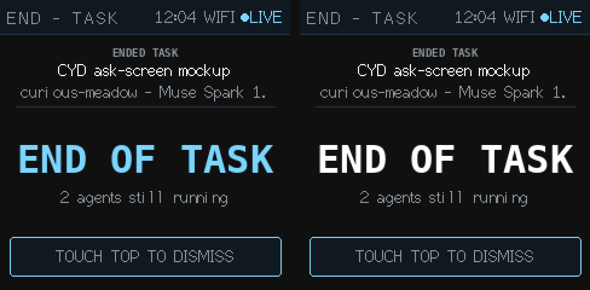
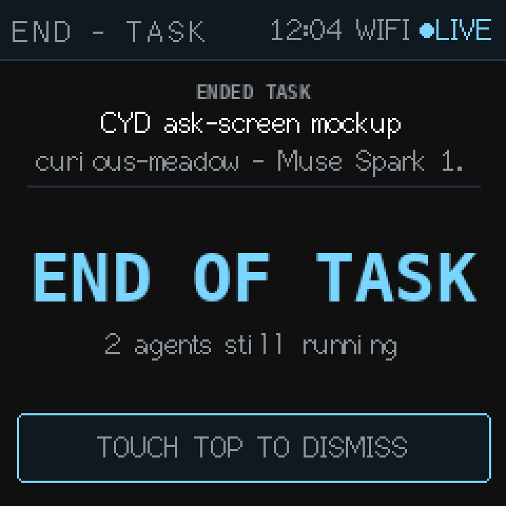

# PLAN — END OF TASK vs END OF WORK (TV-154, feasibility + mockups)

> Scope of this doc: **plan + mockups only, TV version only**. No firmware / bridge code changed.
> Generator: `mock_tv154_endotask_render.py` → `mockup-tv154-endotask-ice.png`
> (recommended) / `mockup-tv154-endotask-white.png` (alt frame) / `mockup-tv154-endotask.png` (combo).
> Existing reference: `mock_tv154_endofwork_render.py` → `mockup-tv154-endofwork*.png`.

## 1. Goal

Split today's single latched state into two user-visible states:

| State | Meaning | Hero | Subline |
|---|---|---|---|
| **END OF WORK** (existing) | Conversation gives back control, **no agents running** | `END OF WORK` (blinks WHITE ↔ ICE) | — none — |
| **END OF TASK** (new) | Conversation is back to user **but N background agents/subagents still running** for this session | `END OF TASK` (**solid ICE**, no blink) | `N agents still running` in smaller font below hero |

Requested mockup: hero `END OF TASK`, and below it in smaller fonts `x agents still running`.

**Verdict: FEASIBLE, small diff.** Bridge can count busy children from the OpenCode
SQLite DB, one extra `running: N` int fits the <150 B `endofwork` budget, firmware
is a hero conditional + subline on the existing `SCR_ENDWORK` screen. No new screen,
no new poll, no SRAM risk.

## 2. Target clarification (important)

Code truth (both targets already share the screen):

- `firmware/src/main.cpp:65-73` — `case SCR_ENDWORK: drawEndWork(...)` is **outside**
  any `#ifndef TV154`. Only SCOPE/CLOCK/ASK are CYD-gated.
- `firmware/include/config.h:68-72` — `SCR_ENDWORK=2` documented for TV154 too.
- `firmware/src/ui/screens.cpp:681-753` — `drawEndWork()` is shared, budget from
  `LAYOUT_W-28`, with a TV154 hint variant (`:744-748`).
- TV154 mock already exists: `mock_tv154_endofwork_render.py`.
- The stale comment `firmware/src/ui/screens.h:13` ("CYD only (TV154 never enters
  SCR_ENDWORK)") is **contradicted by all of the above** — fix the comment, don't trust it.
- Bridge is transport-agnostic (`bridge/src/index.ts`, `transports/http.ts` + serial);
  both targets consume the same `endofwork` block.

Consequence: the split is **one shared firmware change, both widths inherit it**.
This plan ships **TV-154 mockups only** per the request, but implementation will light
up CYD-320 for free (same 11-char hero length → identical auto-fit branch).

## 3. How the bridge distinguishes WORK from TASK

Current detector — `bridge/src/collectors/endWorkWatcher.ts:50-94`:

- Polls OpenCode SQLite `session_v2`, root-only `WHERE parent_id IS NULL` (`:58`).
- Fires when `time_idle > prev && time_busy < time_idle && recent` (`:74`).
- Tick every 5 s (`bridge/src/index.ts:84-86`, `ENDWORK_WATCH_SEC`); device picks it up
  on its 15 s quota poll.

Live schema (verified against real `opencode.db`):

```sql
session_v2(id, parent_id, title, agent, model,
           time_created, time_updated, time_busy, time_idle, ...)
```

Still-running signal = busy subagents + running shells: a child row with
`parent_id = <root id>` and `time_idle IS NULL` (or `time_busy >= time_idle`)
is still busy; a `job` row with `status = 'running'` for the root or its
children (e.g. a background file server) is a still-running shell.
Live proof (verified on-device 2026-11-22): the session writing this plan
went idle with 2 busy children (TASK state), and later a background
file-server shell (`job` row, `status='running'`) correctly flipped a stale
`running: 0` latch to `running: 1` via the per-tick recount.

Counting queries (one extra SELECT per watcher tick, only for the
fired/latched root — never in the HTTP hot path):

```sql
SELECT COUNT(*) AS n FROM session_v2   -- busy subagents (recency-guarded)
 WHERE parent_id = ?
   AND (time_idle IS NULL OR time_busy >= time_idle)
   AND time_updated > ?;  -- now - RECENT_MS (15 min), ignores crashed agents

SELECT COUNT(*) AS n FROM job          -- running shells (no recency guard:
 WHERE status = 'running'              -- a server running for hours is legit)
   AND (session_id = ? OR session_id IN
        (SELECT id FROM session_v2 WHERE parent_id = ?));
```

## 4. Payload change (stays inside budgets)

Current `bridge/src/types.ts:26-33`: `EndWorkInfo { id, title, model, ended_at }`,
comment notes **<150 B** (typical ~95–110 B at max title 23 + model 31).

Proposal — **add one integer only, derive the label firmware-side**.
Do NOT add `kind: "work"|"task"` (redundant, wastes ~13 B):

```ts
export interface EndWorkInfo {
  id: string; title: string; model: string; ended_at: number;
  running: number;   // 0 = WORK, >0 = TASK (busy children count)
}
// serialized delta: `,"running":N` = +12–13 B → ~110–125 B total, still <150 B
```

Bridge touch points (for the later implementation step, NOT done here):

1. `bridge/src/endWorkStore.ts:8-17,45-65` — add `running_agents: number` to
   `EndWorkPending` + `postEndWork` input (clamp 0–99); `getPending`/`getById` unchanged.
2. `bridge/src/collectors/endWorkWatcher.ts:77-81` — pass `running` at fire time;
   plus a per-tick **recount for the currently latched root**, mutating the slot in
   place (no new id → no re-pop; hero flips on next quota poll). Count → 0 from a TASK
   slot → fresh `postEndWork({running: 0})` (new id → re-latch; see §6 risk 2).
3. `bridge/src/index.ts:25-56` — both embed sites (`payloadFrom` + `livePayload`) add
   `running: ew.running_agents`. Serial (`transports/serial.ts:59`) spreads the payload → free.
4. `bridge/src/transports/http.ts:188-208` — `POST /api/endofwork` accepts optional
   `running?: number` (manual/test fires).

## 5. TV-154 240×240 layout spec (what the mockups prove)

All numbers measured by the generator audit block, not estimated.
Palette: `BG 0x1082, CARD 0x10C4, TEXT 0xFFFF, DIM 0x8CB3, ICE 0x7EBF, EDGE 0x2988`
— no new colors. Fonts: font-2 blits for all small text, 32 px DejaVu only for the hero
(per existing mock law). Header: shared `header240()` from `mock_tv154_render.py`
(reused via import — local duplicate deleted). Budget: `212 px` (`LAYOUT_W-28`).

| string | mock F6-46 px | mock 32 px | fw font2 ×3 | fw font2 ×2 | budget |
|---|---|---|---|---|---|
| `END OF WORK` | 304 (overflow +92) | 211 fit (+1) | 258 (overflow +46) | 172 fit (+40) | 212 |
| `END OF TASK` | **304 (overflow +92)** | **211 fit (+1)** | **252 (overflow +40)** | **168 fit (+44)** | 212 |

Both heroes are 11 chars monospace → identical widths → **same auto-fit branch** as
WORK on both mock and glass (mock is the conservative/wider case: if it fits in the
mock it fits on glass — pre-existing divergence, keep, don't "fix").

Vertical stack (sums to 240) — hero + sub centered as ONE block in 88..196:

- header `0..28` — section label **`END - TASK`** (replaces `END - WORK`; measured 94 px,
  ends x=100, clock cluster starts x=128 → **28 px gap**, safe; WORK today is 96 px / 26 px gap, so TASK is strictly safer) + hairline y=28.
- tiny `ENDED TASK` (was `ENDED WORK`) — font1 DIM centered y=38.
- title y=50 font-2 TEXT, sub y=68 font-2 DIM, both truncated to 212 px (unchanged law).
- hairline y=88 `x13..227`.
- zone `88..196` (h=108, center y=142). Block = hero + 10 px gap + 16 px sub.
  32 px hero → block 58 px: **hero y=113..145, sub y=155..171**,
  top clearance 25 / bottom clearance 25, **block center 142 = zone center 142**.
  (Previous draft had the hero alone centered at 142 with the sub at y=168 appended
  below — block center 155, 13 px low. Fixed: `hero_y = center - block/2`.)
- **agents subline `2 agents still running` — font-2 `DIM`, centered, truncated to
  212 px** with the same chop loop. Measured: `1 agent…` 133 px / `2 agents…` 139 px /
  `12 agents…` 147 px — 65–79 px margin.
  Firmware pluralizes: `1 agent still running` singular.
- dismiss button `(8,196,224,32)` r=3 + label `TOUCH TOP TO DISMISS` — unchanged geometry.

Blink/color decision — **solid ICE hero + solid ICE frame, subline static DIM,
ignore `blinkBlue` in TASK state** (recommended; white frame kept only as the alt mockup):

- Blink is this codebase's terminal-latch signature ("demands dismissal"). If TASK blinks
  identically, WORK vs TASK differ only by noun — no at-a-glance state.
- Solid ICE is the live/synced accent (LIVE badge, NEXT countdown); "agents still
  running" is literally live background activity → semantically exact, and costs one line
  (`hero = COLOR_ICE`) instead of a new blink rate/tick change.

Firmware delta (for the later step, NOT done here): `drawEndWork` gains a task flag
(or a `drawEndTask` sharing geometry) — hero string select, `blinkBlue` forced false →
ICE, **block-centering: `hero_y = 142 - (hs + 10 + 16)/2`, `sub_y = hero_y + hs + 10`**,
header `END - TASK`, tiny `ENDED TASK`, hint unchanged.
`quota_state.h:28-33` +1 B `uint8_t endwork_running`; `quota_state.cpp:123-134`
`next.endwork_running = eo["running"] | 0;` (`StaticJsonDocument<2048>` has headroom).
Dismiss/latch reuse 100 % (`main.cpp` `endWorkActive`, top-key dismiss, deferred
`POST /dismiss`, BOOT-never-exits-ENDWORK, ASK-preempts-ENDWORK).

## 6. Risks / edge cases

1. **Frozen count** — fire-time count goes stale as children finish. Mitigate with the
   per-tick recount + 0-transition re-fire (§4.2); without it TASK shows stale counts.
2. **Dismissed-TASK → WORK re-pop** — the 0-transition mints a new id, so a dismissed TASK
   re-latches as WORK when the last child ends. Desired ("tell me when truly done") but
   confirm vs. silent.
3. **Leaked busy rows** (crashed subagent, `time_idle` forever NULL) pin TASK. Mitigate
   with the `time_updated`-recency guard; worst case degrades to today's WORK after 15 min.
4. **Root idle → new children spawn after** — recount covers it (slot flips back to TASK
   in place, no pop — acceptable).
5. **Latency** — TASK→WORK flip lands ≤ ~20 s after last child ends (5 s watcher + 15 s
   quota poll; serial 10 s). Fine for a latch screen.
6. **No `parent_id` index** — fine at session-table scale; keep the recount to one
   `COUNT(*)` per 5 s tick, never in the HTTP hot path (8 s firmware timeout).
7. **CyD-320 inherits automatically** — same 11-char hero, same budget law; no separate
   CYD mock strictly needed, but generate one before merging firmware.

## 7. Mockups (this plan's artifacts)

| file | role |
|---|---|
| `mock_tv154_endotask_render.py` | generator (imports shared `header240`, no geometry fork) |
| `mockup-tv154-endotask-ice.png` | **reference — solid ICE hero** (720×720, ×3 NEAREST) |
| `mockup-tv154-endotask-white.png` | alt TEXT-white frame (documents the rejected blink frame) |
| `mockup-tv154-endotask.png` | side-by-side combo ice \| white (1488×720) |

Audit output (from the generator run):

```text
hero 'END OF TASK': F6-46 304 vs budget 212 -> OVERFLOW
hero 'END OF TASK': 32px 211 vs budget 212 -> fit
hero fw f2x3 252 vs 212, f2x2 168 vs 212
hint 'TOUCH TOP TO DISMISS': f2 148 vs btn inner 222
agents-sub '2 agents still running': f2 139 vs budget 212 -> fit
agents-sub '1 agent still running': f2 133 vs budget 212 -> fit
agents-sub '12 agents still running': f2 147 vs budget 212 -> fit
block: hero 113..145, sub 155..171, block-center 142 vs zone-center 142, clear top 25 / bottom 25
header 'END - TASK': section ends 100, clock starts 128, gap 28
```




## 8. Implementation status (executed 2026-11-22, verified on-device)

Done and live: bridge count (children + shell jobs) + store field +
`root_id` for exact recounts + 2 embed sites + POST passthrough;
`types.ts` running field; firmware struct field + parse + hero conditional
+ block-centered subline + header override + stale-comment fix; TV-154
mockups regenerated; `FW_VERSION` `v0.2` → `v0.3`, bridge `0.1.0` →
`0.3.0`; both `pio` envs build clean. On-device proof: TASK
(`1 agent still running`, the flash file server) → server stopped →
recount to 0 → re-fire as WORK. Correct.

## 9. Next (CYD-320 — DONE 2026-11-22)

1. Bridge: `running` count + store field + 2 embed sites + POST passthrough. ✅ Done.
2. `types.ts` comment/Budget update + bridge unit test (idle root + N busy children →
   TASK; 0 → WORK; recount-to-zero re-fires). ✅ Done (inspection; `node_modules` absent).
3. Firmware: struct field + parse line + hero conditional + subline + stale-comment fix. ✅ Done, shared CYD+TV154.
4. ~~Regenerate TV mockups + add CYD-320 TASK mock before merging firmware.~~ ✅ Both done:
   TV (`mockup-tv154-endotask-*.png`) + CYD-320 (`mock_cyd_endotask_render.py` →
   `mockup-cyd-endotask-ice.png` reference / `-white.png` alt / `-endotask.png` combo,
   hero 211/292, sub 139/292, block-center 142, header gap 108).
5. ~~On-device check.~~ ✅ Done: TASK→WORK flip verified live (see §8); CYD-320 flashed
   from Chromebook via LAN tarball (`cyd-st7789` → white panel → `cyd-ili9341` correct,
   `RAM 17.1% / Flash 35.6%`). Stable one-liners documented in `README.md` Install §2.

---
*Sources: @esp32-expert feasibility (bridge counting query, payload +1 B SRAM deltas,
risk list) + @sarmi-esp32-UIX layout spec + fit audit (all numbers measured). Plan +
mockups only at first — runtime implemented, built, and verified on-device 2026-11-22.*
