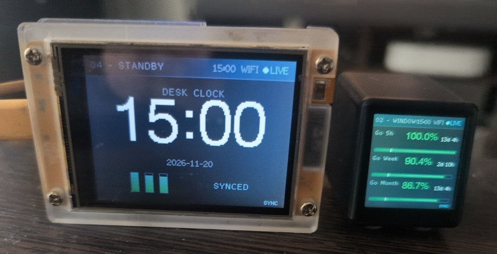
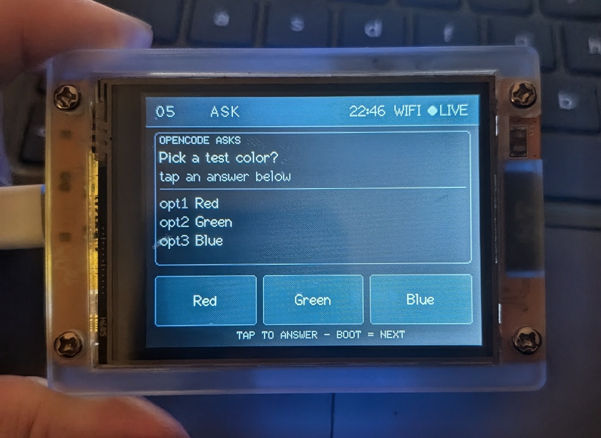
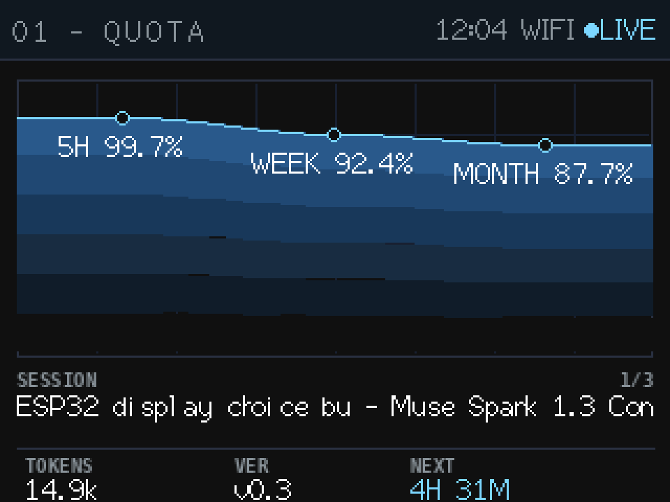
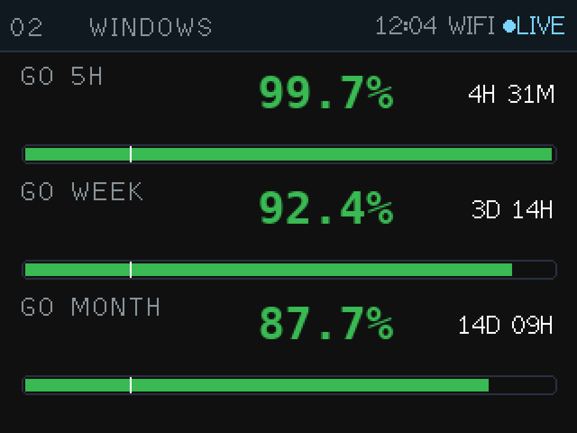
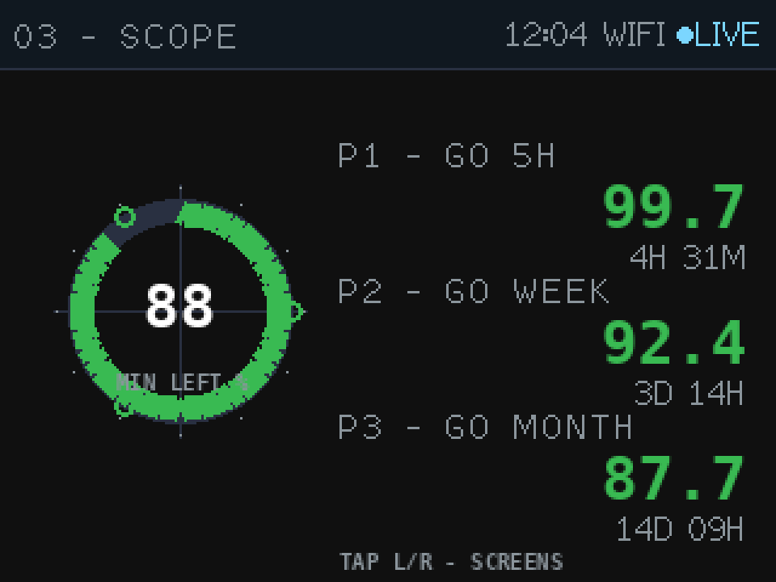
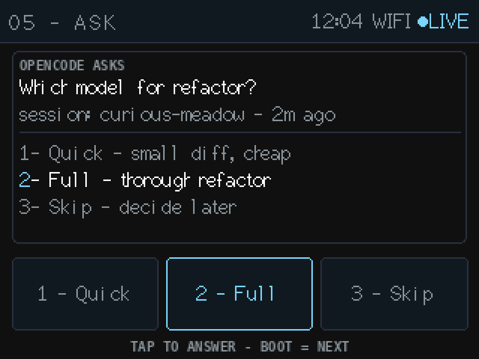

# AI Quota Monitor

Standalone desktop hardware dashboard for real-time **OpenCode** quota
monitoring (Go 5h / Week / Month windows, daily tokens, live session
readout), **firmware v0.3** shown in the readout strip
(`TOKENS | VER | NEXT`).

> **Changelog:** see [CHANGELOG.md](CHANGELOG.md).

## Screenshots

| Real View Both Device | Reak Ask View |
|---|---|
|  |  |

| Quota overview | Provider details |
|---|---|
|  |  |

| Scope view | Ask view |
|---|---|
|  |  |

## Explaination

> **OpenCode only.** `PLAN.md` still describes an old Antigravity two-source
> vision, but nothing Antigravity is implemented: the bridge collects
> exclusively from OpenCode (Console API, `opencode-quota` fallback, local
> DB/stats), and the firmware renders only OpenCode windows + sessions.

Two parts: a **bridge** (Node.js daemon on the PiBiatch that reads local
OpenCode quota + session data and serves it over LAN HTTP / USB serial) and
the **firmware** (PlatformIO dashboard). One bridge serves both hardware.

See `PLAN.md` for the original implementation plan and `PLAN-CYD-ASK.md` for
the question-answering design.

```text
.
├── README.md
├── PLAN.md / PLAN-CYD-ASK.md
├── bridge/      # Node.js collector + LAN HTTP/Serial server (shared, both boards)
│   └── src/
│       ├── index.ts            # entry: HTTP + mDNS + optional serial
│       ├── types.ts            # QuotaPayload + SessionInfo + Ask contracts
│       ├── askStore.ts         # single-slot question queue w/ 30s fallback
│       ├── ask-cyd.sh          # ask via device, fall back to app on timeout
│       ├── mock.ts             # mock data generator (--mock)
│       ├── collectors/opencode.ts  # Console API + stats CLI + DB fallback + sessions
│       └── transports/{http,serial}.ts
├── firmware/    # PlatformIO ESP32 project (both boards below)
│   ├── platformio.ini          # cyd-st7789 / cyd-ili9341 / tv154-st7789 / tv154-diag
│   ├── flash-cyd.sh            # full sync + build + flash script (all envs)
│   ├── include/                # config.h (pins, screens, FW_VERSION) + ui_theme.h
│   └── src/                    # network, quota_state, ask_state, led, ui/* screens
├── mock_hw_render.py   # pixel-honest CYD emulator (PIL, real TFT glyphs)
├── mock_tv154_render.py  # pixel-honest TV-154 emulator (imports CYD glyph path)
├── hw-ov.png / hw-prov.png / hw-scope.png / hw-ask.png            # CYD mockups
├── hw-ov2 / prov2 / scope2 / clock2.png                           # CYD pure-black proposals
└── hw-tv154-ov.png / hw-tv154-prov.png                           # TV-154 240x240 mockups
```

## Install (quickstart)

Prerequisites: Node.js 22+ on the PiBiatch, OpenCode with local data
(`~/.local/share/opencode/opencode.db`), the board on USB, PlatformIO
(`pip install --user platformio`) only if you build from source.

1. **Bridge** (PiBiatch, once):
   ```bash
   cd bridge && npm install && cp .env.example .env && npm run build
   setsid nohup node dist/index.js > /tmp/opencode/bridge.log 2>&1 < /dev/null &
   curl http://127.0.0.1:3847/health   # {"ok":true,...}
   ```
   Keep `HOST=0.0.0.0` in `.env` so the board can reach it over LAN.
2. **Flash** (v0.3, from the repo checkout — paste.rs retired):
   ```bash
   cd firmware && PORT=/dev/ttyUSB0 bash flash-cyd.sh tv154-st7789   # TV-154 1.54" (this release)
   PORT=/dev/ttyUSB0 bash flash-cyd.sh cyd-st7789                    # CYD 2.8" (same binary split)
   ```
   White/inverted CYD screen → re-run with `cyd-ili9341`. Black TV-154
   screen → flash `tv154-diag` and report which color step lights up
   (see Troubleshooting).
3. **Wi-Fi + bridge address**: on first boot the board opens the
   **`AI-Quota-Setup`** access point. Join it from a phone/laptop, enter
   your Wi-Fi credentials and the bridge host = PiBiatch **LAN IP**
   (e.g. `192.168.1.59` — `*.local` names routinely fail on hotspots),
   port `3847`, poll `15`. Saved to NVS; survives reflash.
4. **Verify**: device shows 01-QUOTA with live % bars; bridge side
   `curl http://<lan-ip>:3847/api/quota` returns JSON; serial
   `pio device monitor --port /dev/ttyUSB0 -b 115200` prints
   `ai-quota-monitor boot ok` + `heap=...` lines.

Chromebook (Crostini) — share the USB-serial device with Linux first
(Settings → Developers → Linux → Manage USB devices), then paste this
**one line** in the Linux terminal (pulls the v0.3 sources as a LAN tarball
from the PiBiatch and flashes the TV-154):

```bash
curl -fsSL http://192.168.1.59:8000/ew.tgz | tar -xz -C ~ && cd ~/firmware && PORT=/dev/ttyUSB0 bash flash-cyd.sh tv154-st7789
```

`sudo chmod 666 /dev/ttyUSB0` fixes permission errors; swap `tv154-st7789`
for `cyd-st7789` (or `cyd-ili9341` for white/inverted CYD) for the 2.8" board.
PlatformIO is required in the Chromebook Linux container once:
`pip install --user platformio --break-system-packages`.

Publish the tarball (PiBiatch, once per release):

```bash
cd ~/AI-Quota-Monitor && tar -czf /tmp/ew.tgz firmware && (cd /tmp && python3 -m http.server 8000)
```

## Hardware versions

| | **CYD** (original) | **TV-154** (port) |
|---|---|---|
| Board | `ESP32-2432S028R` (NMMiner NM-CYD) | NM-TV-154 (ESP32-D0) |
| Display | 2.8" 320×240 landscape (ST7789 / ILI9341) | 1.54" 240×240 square (ST7789, HSPI, `CGRAM_OFFSET`) |
| Input | XPT2046 resistive touch + BOOT button | 1 capacitive top key (T9/GPIO32): tap = next screen, hold 5 s = wipe Wi-Fi + portal |
| LED / sensor | RGB LED + LDR auto-backlight | none (fixed full backlight) |
| Backlight / power | BL `GPIO21` | BL `GPIO19` active-low, LCD power rail `GPIO21` active-low (must be enabled or the screen stays black) |
| Screens | 01 QUOTA · 02 WINDOWS · 03 SCOPE · 04 STANDBY · 05 ASK | **01 QUOTA · 02 WINDOWS only** (same bridge, same data) |
| Env | `cyd-st7789` (default) / `cyd-ili9341` | `tv154-st7789` (`tv154-diag` = PWR/BL sweep test) |
| Firmware | v0.3 (strip VER field) | v0.3 (strip VER field) |

## 1. Bridge — running manual (detail)

Requirements: Node.js 22+, the OpenCode SQLite DB on the same machine
(default `~/.local/share/opencode/opencode.db`), LAN reachability from the device.
Quickstart in Install §1; full reference below.

```bash
cd bridge
npm install
cp .env.example .env   # optional; defaults work out of the box
npm run build
node dist/index.js                 # live data
node dist/index.js -- --mock       # simulated data (UI testing)
```

Environment (`bridge/.env.example` documents most of these):

| Var | Default | Meaning |
|---|---|---|
| `PORT` / `HOST` | `3847` / `0.0.0.0` | HTTP listen. Must be `0.0.0.0` for LAN. |
| `MDNS_NAME` | `quota-bridge` | mDNS advertisement (`quota-bridge.local`). |
| `POLL_OC_SEC` | `45` | Collector cache TTL (= Console poll interval). |
| `OPENCODE_DB` | `~/.local/share/opencode/opencode.db` | Credential + usage + session DB path. |
| `OPENCODE_QUOTA_BIN` | `npx` | Fallback: `opencode-quota show --json` reader. |
| `SESSION_ACTIVE_MIN` | `10` | Session counts as active if touched within N minutes. |
| `CYD_BRIDGE_URL` | `http://192.168.1.59:3847` | Used by `ask-cyd.sh` (LAN IP of the PiBiatch). |
| `SERIAL_PORT` / `SERIAL_BAUD` / `SERIAL_INTERVAL_SEC` | _(unset)_ / `115200` / `10` | Optional USB Serial push. Also `--serial /dev/ttyUSB0`. |

Endpoints:

- `GET /api/quota` → `{ ts, overall_status, opencode: { connected, today_cost_usd, today_tokens_k, providers[], sessions[] } }`. Each provider: `{ name, remaining_pct, reset_in_sec, status }` with `ok ≥ 50 > warn ≥ 20 > crit`. Each session: `{ title, model }` (pretty model name, e.g. `Muse Spark 1.3 Contributor` — no provider prefix, no thinking level).
- `GET /health` → `{ ok, ts, ask_pending, endwork_pending }`.
- `GET /api/ask` → pending question or `204` when none. `?id=` returns that question's state, including the answer once resolved.
- `POST /api/ask { question, options[], session?, detail?, timeout_sec? }` → creates a pending question (replaces any previous one). Options are strings or `{ id, label }` (max 4, labels ≤ 24 chars, question ≤ 120 chars).
- `POST /api/ask/answer { id, option_id }` → records the tap. `410` when the question is gone.
- `GET /api/endofwork` → pending ended-work/task event or `204`. `POST /api/endofwork { title, model?, session?, running? }` → latches it (replaces). `POST /api/endofwork/dismiss { id }` → clears it (`410` when gone). The pending event is embedded in `GET /api/quota` as `endofwork: { id, title, model, ended_at, running }` so the device picks it up on its normal poll (`running: 0` = WORK, `>0` = TASK).

Data sources (in order, each isolated so one failure never crashes the bridge):
1. OpenCode Console `/api/go/status` with the OAuth login from the local DB (5h/weekly/monthly meters).
2. `opencode-quota show --json` export-cache fallback.
3. Daily tokens/cost from `opencode stats --days 0 --json`, else `session_v2` DB SUM.
4. Active sessions from `session_v2` (`time_updated` within `SESSION_ACTIVE_MIN`), most-recent first, max 4.
5. Last-known values marked `stale: true`, else `connected: false`.

Keep-alive (the bridge must survive shell exits — use `setsid`):

```bash
cd bridge && npm install && npm run build  # after pulling v0.3 sources
cd bridge && setsid nohup node dist/index.js > /tmp/opencode/bridge.log 2>&1 < /dev/null &
curl http://<lan-ip>:3847/health
```

Reference deployment: PiBiatch, LAN IP `192.168.1.59`, port `3847`.

### Asking via the device (CYD 05 · ASK only)

`bridge/ask-cyd.sh` posts a question, waits for the hardware answer, and falls
back to the app when the device stays silent (TV-154 has no ASK screen):

```bash
if ans=$(./bridge/ask-cyd.sh "Which model for refactor?" "Quick patch" "Full rewrite" "Skip"); then
  echo "hardware answered: $ans"
else
  echo "no answer in 30s — ask back in the app"
fi
```

Flags: `--timeout 30` (default 30s), `--bridge URL`. Exit `0` prints the
tapped label; exit `2` means timeout (question expired on the bridge, nothing
to clean up); exit `3` is a usage/bridge error. The agent flow is: try the
hardware first, on exit `2` ask natively instead.

## 2. Firmware — flashing + setup (detail)

One line per board — full commands in Install §2:

- `bash -s -- cyd-st7789` — CYD 2.8" (ST7789 default; white/inverted screen → `cyd-ili9341`)
- `bash -s -- tv154-st7789` — TV-154 1.54" (01 + 02 only)
- `bash -s -- tv154-diag` — TV-154 PWR/BL sweep test (4 colors + serial labels)

Hold `BOOT` + tap `RST` if upload fails to sync (CYD); on TV-154
power-cycle into flash mode and retry.

First boot with no Wi-Fi opens the **`AI-Quota-Setup`** access point. Join
it from a phone/laptop and set **Bridge host to the PiBiatch's LAN IP**
(e.g. `192.168.1.59` — mDNS `*.local` routinely fails on hotspots), port
`3847`, poll interval `15`. Credentials persist in NVS.

Screens (CYD: tap left/right halves to cycle, top bar = force refresh,
BOOT short-press = next screen, BOOT > 5 s = wipe Wi-Fi + reopen portal;
TV-154: tap top key = next screen (01↔02), hold 5 s = wipe + portal):

1. **01 · QUOTA** — hero quota curve, per-window labels, SESSION strip
   (conversation title + pretty model, `x/y` pager rotating every 10 s,
   pager hidden when only one session is active), TOKENS / VER / NEXT strip
   (VER = firmware version, currently `v0.3`).
2. **02 · WINDOWS** — per-window rows with centered big `%` and
   right-aligned readable reset countdowns + thick bars.
   **TV-154** runs 01 + 02 only (same bridge, same data) plus END - WORK
   (below); no 03/04/05 screens.
3. **03 · SCOPE** (CYD only) — big min-level ring gauge + per-window readouts.
4. **04 · STANDBY** (CYD only) — desk clock + level bars.
5. **05 · ASK** (CYD only) — pops up automatically when `GET /api/ask` reports a
   pending question (polled every 5 s). Question + option preview on top,
   large answer buttons at the bottom (2/3/4-option layouts). A tap posts
   `/api/ask/answer` and returns to QUOTA; expiry clears back automatically.
6. **END latch — WORK vs TASK** — latches when a user-facing OpenCode
   conversation goes idle (bridge watches `session_v2` `time_idle`, fires
   within ~5 s, or `POST /api/endofwork` manually / `bridge/endofwork-cyd.sh`).
   Both states stay until dismiss (CYD: any screen touch; TV-154: top-key tap,
   no ASK screen involved), which also posts `/api/endofwork/dismiss` to clear
   the bridge slot. TV-154 shows `TOUCH TOP TO DISMISS`;
   CYD shows `TOUCH SCREEN TO DISMISS`.
   - **END OF WORK** (`running: 0`, fully done): ended work + single centered
     `END OF WORK` hero blinking white ↔ ice-blue (2 s tick + every poll).
   - **END OF TASK** (`running: N > 0`, conversation back but N background
     agents/shells still running): `END OF TASK` hero in solid ice-blue (no blink) +
     `N agents still running` subline below it (`1 agent…` singular); the pair
     is centered as one block between the hairline and the dismiss button.
     The bridge counts busy subagents (`session_v2` children) **plus running
     background shells (`job` table, `status='running'`)**.
     When the last one finishes the bridge re-fires the slot as WORK.

LED (CYD only): green ok / amber warn / breathing-red crit / dim-blue pulse
offline. Backlight follows the LDR (EMA + deadband, full swing <5s) with a readable floor.
TV-154: fixed full backlight, no LED.

Security: LAN-open by design (no auth on GETs, CORS `*`), same as the quota
path. For shared networks set `CYD_TOKEN` in the bridge `.env` — the bridge
then requires `Authorization: Bearer <token>` on `POST /api/ask` and
`POST /api/ask/answer`. The firmware sends the token when `CYD_TOKEN` is baked at
build time. USB Serial mode is push-only (quota+ask frames, no answer uplink).

Troubleshooting: white/inverted screen (CYD) → try the other env (see panel note);
black screen (TV-154) → LCD power rail `GPIO21` must be driven LOW (done in
`displayInit`), backlight `GPIO19` LOW = on; run `tv154-diag` env (PWR/BL
sweep, 4 colors) to find your unit's polarity;
`Couldn't sync` → BOOT-hold sequence (CYD) / power-cycle (TV-154);
marginal USB cable + full-bright backlight + Wi-Fi TX peaks = classic
brownout/reboot loop — use a short cable or powered hub (CYD AUDIT M12).
Flashing wipes NMMiner; restore
anytime via `https://flash.nmminer.com` (TV-154: device `nm-tv-154`).

Partitions: `huge_app.csv` = NO OTA. Every future update needs USB. This is
intentional for single-app desk use; switching to an OTA layout costs flash
and needs re-partitioning (CYD AUDIT H6).

## 3. Mockups (hardware-honest)

`mock_hw_render.py` (CYD) / `mock_tv154_render.py` (TV-154) emulate the
framebuffer: exact RGB565 palette, decoded real TFT_eSPI font-2 glyphs, same
curve/truncation algorithms as the firmware, 1× canvas nearest-upscaled ×3:

```bash
python3 mock_hw_render.py       # writes hw-ov/prov/scope/ask.png (+ v2 proposals)
python3 mock_tv154_render.py   # writes hw-tv154-ov/prov.png (240x240)
python3 mock_tv154_endotask_render.py  # writes mockup-tv154-endotask-ice/white.png + combo (END OF TASK, v0.3)
python3 -m http.server 8080  # view from another machine on the LAN
```

Rules: the emulator mirrors the firmware (fix firmware first, then the
emulator), never the other way around.

## 4. Helpers

- `sarmi-esp32-UIX` OpenCode agent (`~/.config/opencode/agents/`) — senior
  ESP32 UI/UX designer with all project rules (palette law, font metrics,
  mockup pipeline, flash/deploy checklist). Invoke with
  `Use the sarmi-esp32-UIX subagent to …`.
